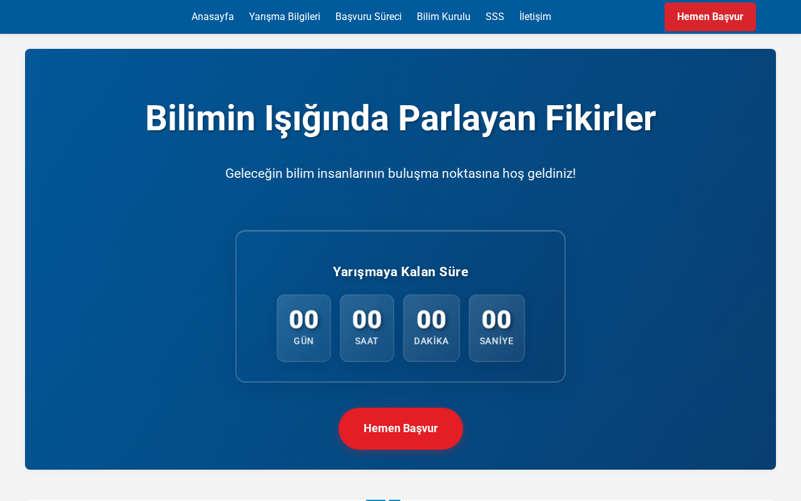
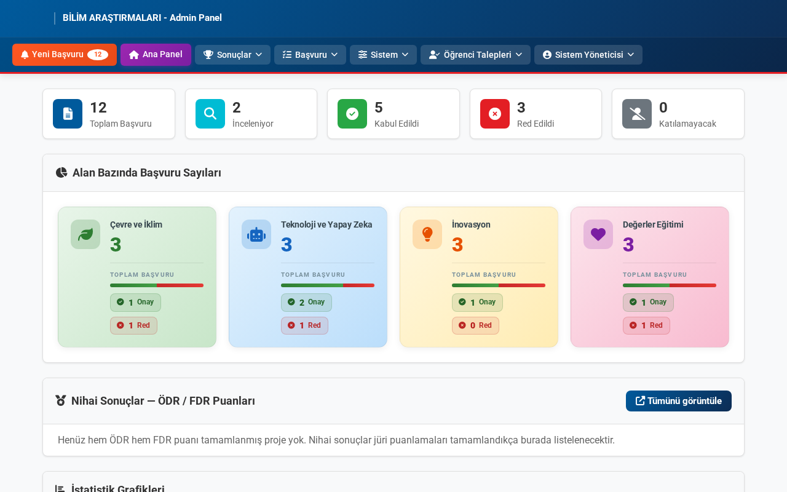

English | [Türkçe](bilim-senligi-basvuru-sistemi.tr.md)

# Science Fair Application System

Applications for a project competition were getting lost between email and spreadsheets.

## What I built

A system that covers everything from application to results. It started as a simple form and grew into jury scoring, result lookup and a ceremony screen.

_Screenshots use made-up demo data._

## Key features

- Online application form for students
- Moderator pre-review, then jury scoring against set criteria
- Jury accounts with bulk import and export
- Publishing results with a lookup page and bulk email
- Invitation and certificate lists, and a screen for the award ceremony

## Stack

PHP, MySQL, Composer, SMTP mail

## My role

I wrote and maintained it, adding features as the competition grew.

## Outcome

Applications, judging and results all in one place instead of email threads.

---

The source code is private. I'm happy to show a demo or walk through the code on request.

[← Back to profile](../README.md)
