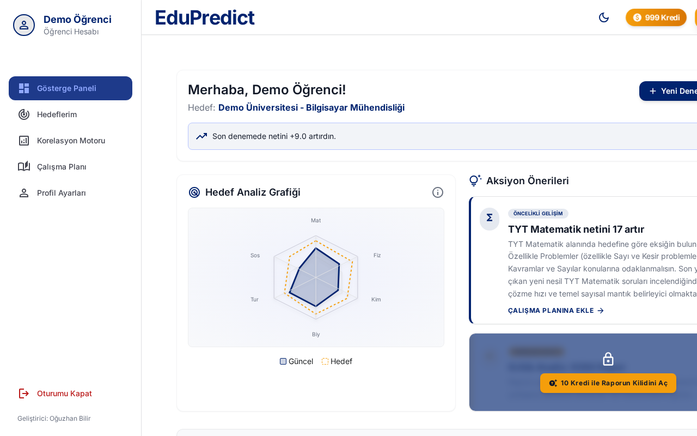
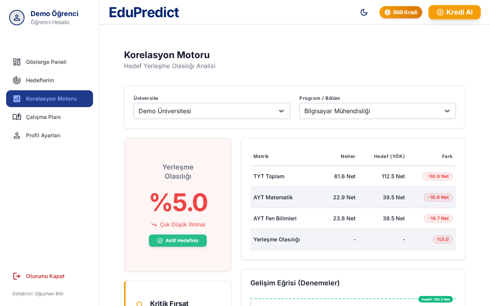

Türkçe | [English](edupredict.md)

# EduPredict

Üniversite sınavına hazırlanan öğrenciler, deneme netlerinin hedefledikleri bölüme ne kadar yakın olduğunu görmek istiyordu.

## Ne yaptım

Öğrencinin deneme netlerini girip ders ders geçmiş yılların taban değerleriyle karşılaştırdığı bir panel.

_Ekran görüntülerindeki veriler uydurma demo verisidir._

## Öne çıkanlar

- Her derste ne kadar açık olduğunu ve yerleşme ihtimalini gösteriyor
- Öğrenci, rehber öğretmen ve yönetici rolleri
- Öğretmen öğrencilerinin denemelerini toplu yüklüyor, yönetici taban puan verilerini içe aktarıyor
- Demo ödeme ekranlı kredi sistemi; sadece prototip, gerçek bir ödeme ya da reklam altyapısına bağlı değil

## Teknolojiler

Python, FastAPI, SQLite, tek sayfalık HTML arayüz

## Rolüm

Backend'i ve arayüzü ben tasarlayıp yazdım.

## Sonuç

Çalışan bir prototip. Örnek taban puan verileri gösterim amaçlı.

---

Kaynak kod özel. İstenirse demo gösterebilir ya da kodu birlikte inceleyebiliriz.

[← Profile dön](../README.tr.md)
