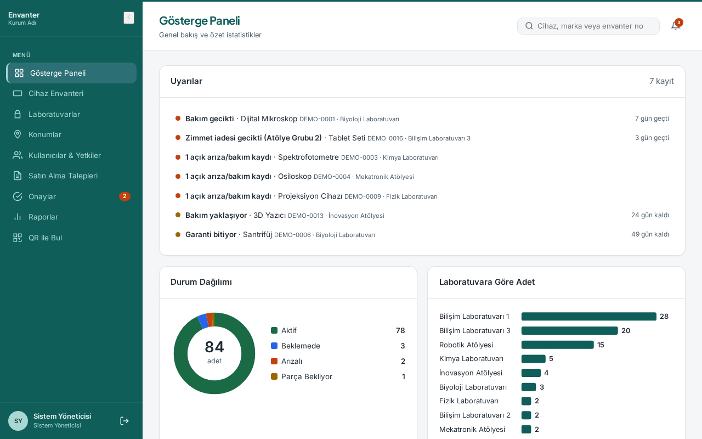
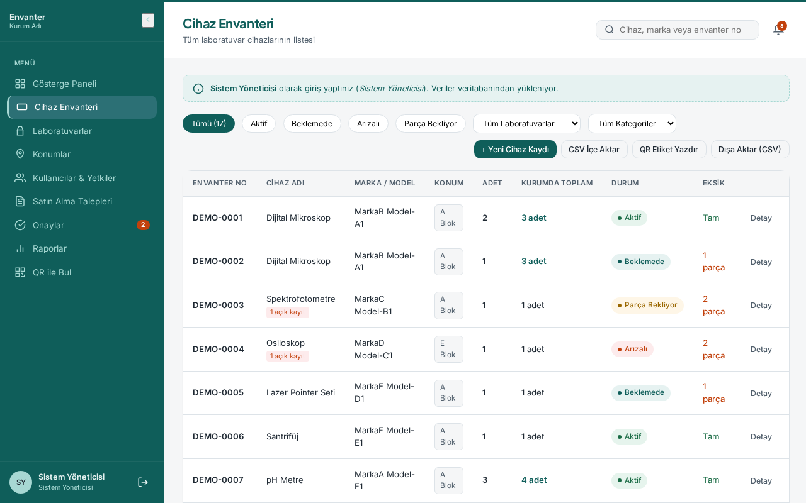

Türkçe | [English](envanter-takip-sistemi.md)

# Envanter Takip Sistemi

Laboratuvar cihazları dağınık tablolarda takip ediliyordu. Hangi cihazın arızalı olduğu, parça beklediği ya da kalibrasyonunun geldiği bir bakışta görülmüyordu, aynı şey bazen iki kez alınıyordu.

## Ne yaptım

Her laboratuvarın cihazlarını, bakım ve kalibrasyon tarihlerini, arızalarını ve eksik parçalarını tek yerde tutan, üstüne satın alma talep akışı eklenmiş bir web uygulaması.

_Ekran görüntülerindeki veriler uydurma demo verisidir._

## Öne çıkanlar

- Satın alma talebi: laboratuvar sorumlusu açıyor, satın alma stok kontrolü yapıp envanterdeki benzer cihazları not düşüyor, müdür onaylıyor ya da gerekçe yazıp reddediyor
- Onaylanıp teslim alınan cihaz doğrudan envantere giriyor
- Cihaz zimmetleme ve iade, arıza ve bakım kayıtları, her cihaz sayfasında zaman çizelgesi
- Ana sayfada yaklaşan bakım/kalibrasyon ve açık arıza uyarıları, durum ve laboratuvar grafikleri
- QR etiket: telefon kamerasıyla okutunca cihaz sayfası açılıyor
- Yetkiler sunucu tarafında: laboratuvar sorumlusu sadece kendi laboratuvarlarını görüyor; hareket geçmişi; CSV dışa aktarma ve önizlemeli CSV içe aktarma

## Teknolojiler

PHP 8 (JSON API), MySQL/MariaDB, düz HTML ve JavaScript, projeye gömülü QR kütüphaneleri (CDN yok)

## Rolüm

Veritabanı, API, arayüz ve kurulum betiği dahil hepsini ben tasarlayıp yazdım.

## Sonuç

Gerçek laboratuvar kullanımı için yazıldı; demo kurulum sadece uydurma örnek veriyle geliyor.

---

Kaynak kod özel. İstenirse demo gösterebilir ya da kodu birlikte inceleyebiliriz.

[← Profile dön](../README.tr.md)
