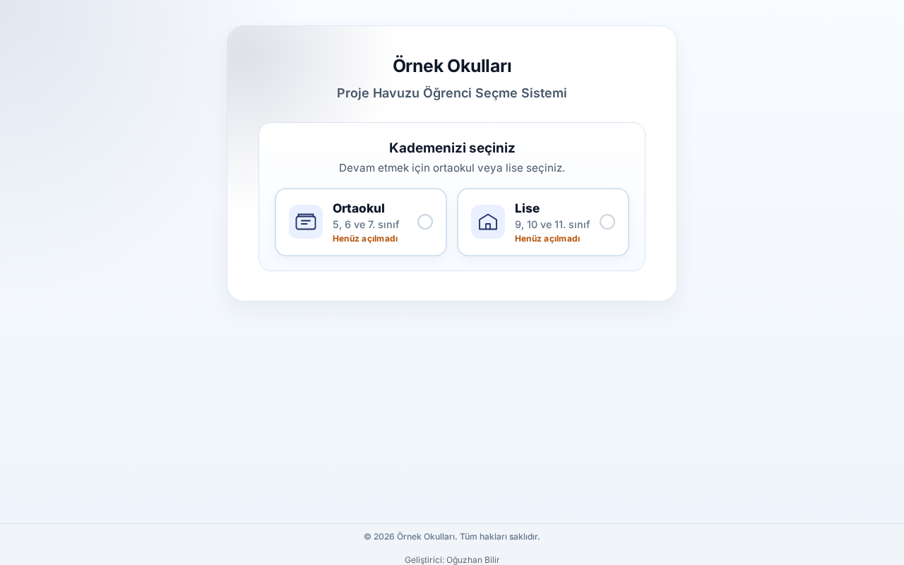
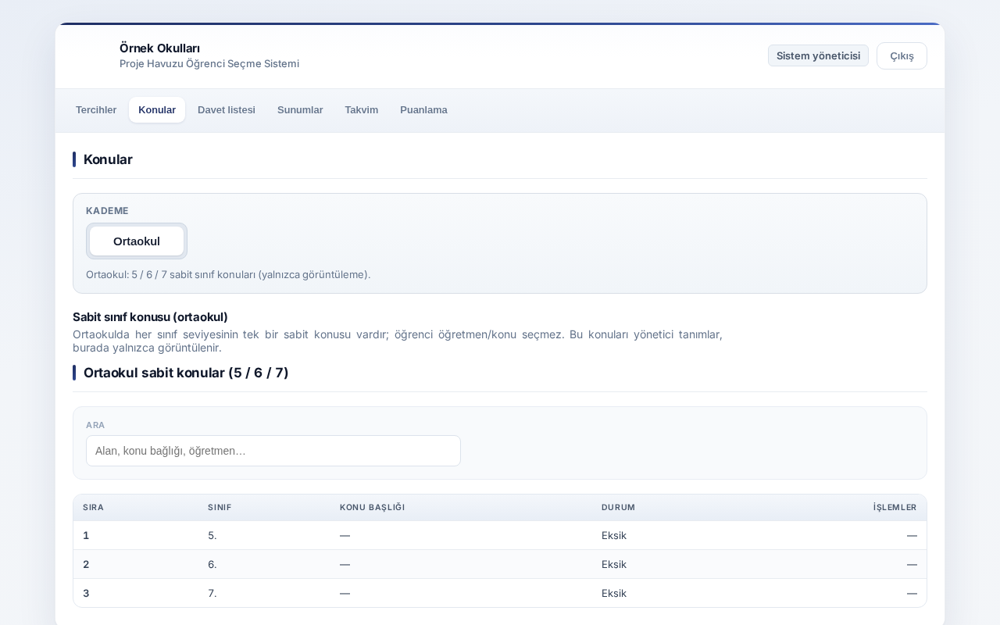

English | [Türkçe](proje-secim-sistemi.tr.md)

# Project Selection System

Every term, students picking a research topic and an advisor took weeks of paper forms and manual matching.

## What I built

A system where students make their choice within set dates, and teachers handle matching, the presentation schedule and scoring.

_Screenshots use made-up demo data._

## Key features

- Students choose a subject, teacher and topic; a choice closes when its quota is full
- Device binding so nobody can choose on someone else's behalf; locks can be reset from the panel
- Admin panel for terms, matching, presentation calendar and scores, with an archive of past terms
- Scores and schedule export to Excel; activity logs

## Stack

PHP, MySQL, plain JavaScript

## My role

I designed and built it end to end.

## Outcome

Moves project selection from paper and manual matching to one online flow.

---

The source code is private. I'm happy to show a demo or walk through the code on request.

[← Back to profile](../README.md)
