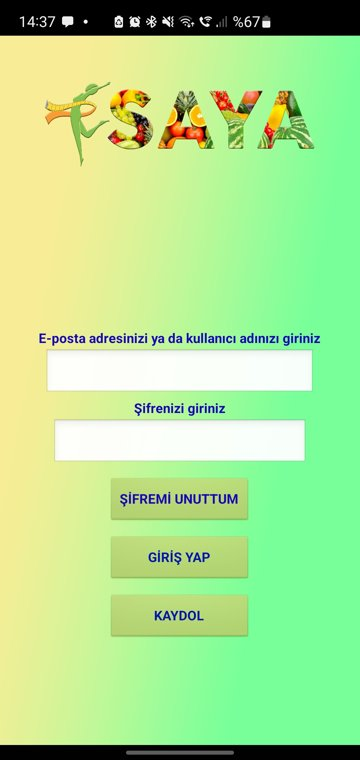
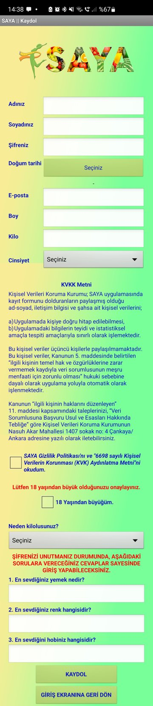
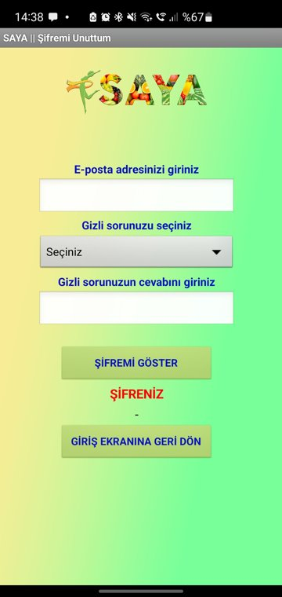
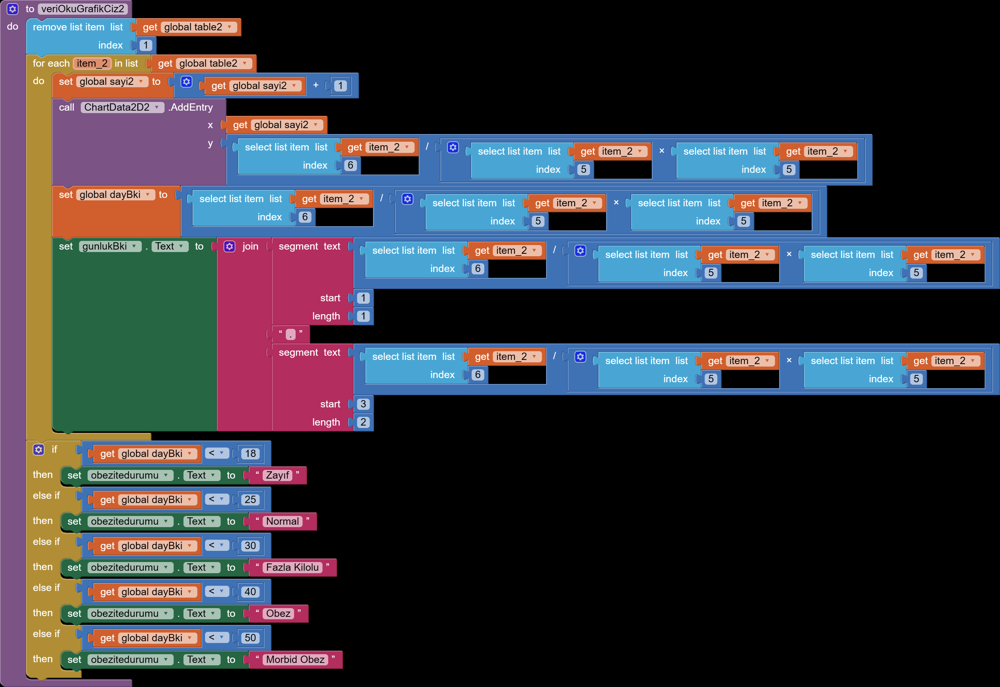

English | [Türkçe](saya.tr.md)

# SAYA Healthy Living

Childhood and teen obesity is a growing problem, and habits formed at that age tend to stick.

## What it is

An Android app for ages 10 to 17 that helps users build healthy eating and activity habits. Two middle school students designed and coded it with me as their advisor.

## Key features

- A short sign-up survey personalises the daily tasks
- Points, leagues and rewards for completing tasks and keeping a streak
- Tested with the target group; bugs fixed and the final version shaped by their feedback
- A user guide so people don't get lost in the app

## Screens

## How it works

- **Data:** there is no separate backend. Sign-up answers go into a Google Sheet through a Google Form, and the app reads the sheet back with App Inventor's Web component.
- **Sign-in:** the email is trimmed and lower-cased, then matched with the password against the sheet rows. The matching row index is kept for the session.
- **Sign-up:** checks for empty fields, email format, an already registered email, KVKK consent and age confirmation. Height, weight and three security questions are collected.
- **Daily score:** the home screen has checkboxes for food groups (water, dairy, eggs, grains, vegetables, nuts and fruit, red meat, deli meat, oil, crisps and chocolate), breakfast, activity time and screen time. Each one adds to or takes from the day's SAYA score.
- **Profile:** BMI is computed from the stored height and weight, drawn as a daily chart, and labelled underweight / normal / overweight / obese / morbidly obese.

Looking back, the weak spot is security: passwords sit in a spreadsheet and the recovery screen shows them in plain text. Today I would use Firebase Authentication and keep the data in Firestore.

## Stack

MIT App Inventor 2, Android

## My role

Advisor: I guided the students through design, coding and testing.

## Outcome

3rd in Turkey at an inter-middle-school project competition (2023).

---

The source code is private. I'm happy to show a demo or walk through the code on request.

[← Back to profile](../README.md)
