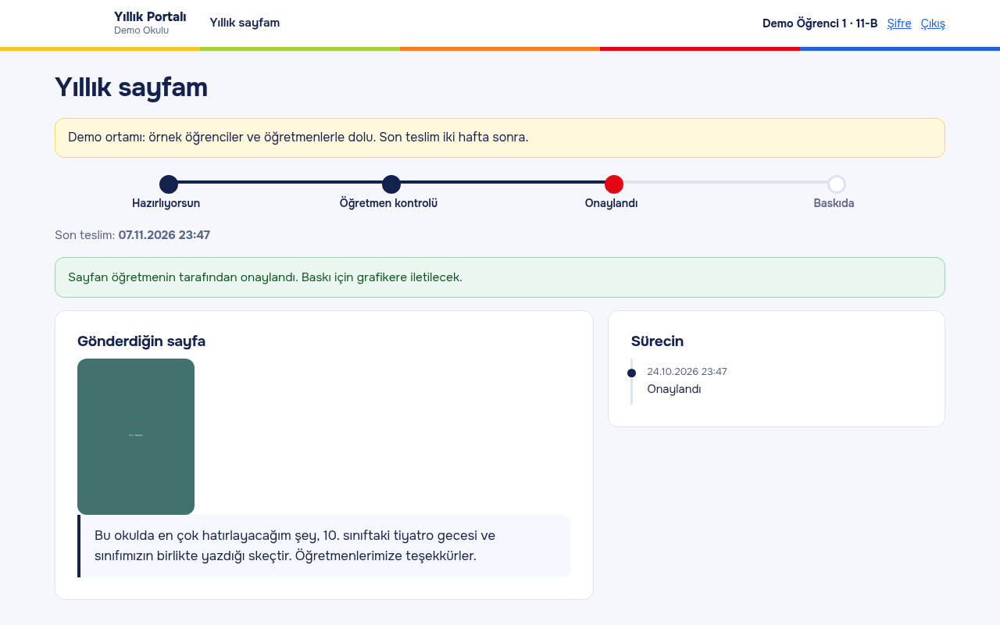
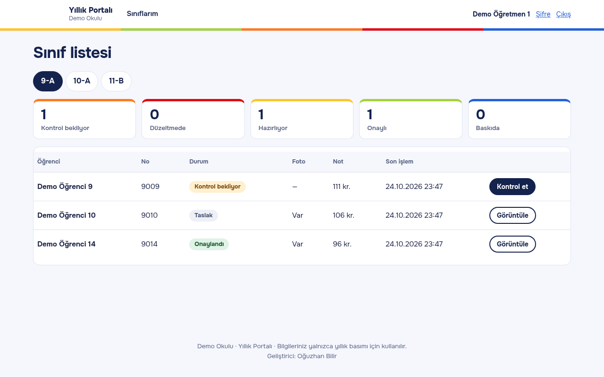

English | [Türkçe](yillik-yonetim-sistemi.tr.md)

# Yearbook Management System

While putting together a graduation yearbook, student texts and photos arrived from everywhere, in every format.

## What I built

A small portal that collects everything in one place, runs it past teacher review and hands it to the printer as a package.

_Screenshots use made-up demo data._

## Key features

- Students write their text and upload a photo
- Teachers approve or ask for changes
- If a photo has the wrong ratio, the student is asked to crop and re-upload instead of the system cropping it
- Approved entries export as ZIP and CSV; the printer account can only download these

## Stack

PHP 8.1, SQLite (chosen so it installs easily)

## My role

I built it on my own, from the data model to the review flow.

## Outcome

Collecting entries becomes one review queue instead of scattered messages.

---

The source code is private. I'm happy to show a demo or walk through the code on request.

[← Back to profile](../README.md)
